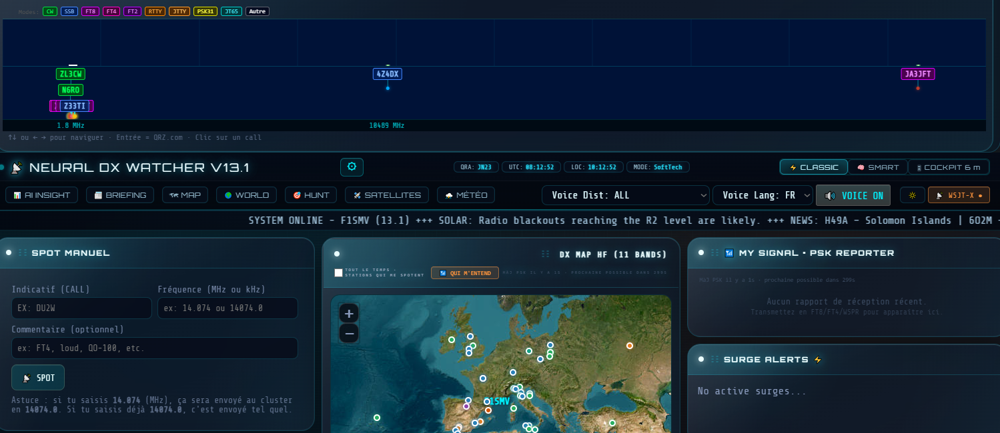

# 🛰️ Neural DX Watcher

> Real-time DX monitoring platform for amateur radio operators — F1SMV / JN23  
> Raspberry Pi · Flask · SQLite · Leaflet.js · WSJT-X · Adaptive AI Insight Engine

---

## 📸 Preview



---

## Contents

- [Overview](#-overview)
- [Technology stack](#-technology-stack)
- [Version history](#-version-history)
  - [v13.1 — Consolidation and release preparation](#v131--consolidation-and-release-preparation)
  - [v13.0 — Adaptive Insight Engine](#v130--adaptive-insight-engine)
  - [v12.7 — Fixes and polish](#v127--fixes-and-polish)
  - [v12.6 — VOACAP HF propagation](#v126--voacap-hf-propagation)
  - [v12.5 — Birth of the AI Insight Engine](#v125--birth-of-the-ai-insight-engine)
  - [v12.2 — MSK144 and satellites](#v122--msk144-and-satellites)
  - [v12.1 — Beacons and lightning](#v121--beacons-and-lightning)
  - [v11.x — Data and infrastructure](#v11x--data-and-infrastructure)
  - [v9.5 — Foundations and roadmap](#v95--foundations-and-roadmap)
- [AI Insight page — Detailed architecture](#-ai-insight-page--detailed-architecture)
- [Deployment](#-deployment)
- [Available APIs](#-available-apis)
- [v13.0 specification baseline](#-v130-specification-baseline)
- [Next steps](#-next-steps)

---

## 🎯 Overview

Neural DX Watcher is a personal, web-based DX monitoring application for amateur radio. It combines live DX cluster spots over Telnet, local WSJT-X UDP decodes, solar propagation indicators (SFI/K/A), space weather, VHF/UHF beacons, SGP4 satellite tracking, and weather/lightning correlations.

Since v12.5, the application has included an experimental **adaptive AI Insight Engine** designed to forecast propagation openings, measure prediction errors, and optimize its own parameters overnight — an ambitious research-oriented feature for a single-developer Raspberry Pi project.

---

## 🔧 Technology stack

| Component | Technology |
|-----------|------------|
| Backend | Python / Flask (local virtual environment observed with Python 3.13) |
| Databases | SQLite (`analytics.sqlite`, `predictor.sqlite`) |
| Frontend | Leaflet.js, SortableJS, Space Grotesk / IBM Plex Mono |
| Solar data | NOAA SWPC (SFI, K, A) |
| HF propagation | VOACAP (introduced in v12.6) |
| Weather / tropospheric conditions | Open-Meteo (850 hPa, humidity, CAPE) |
| Lightning | Blitzortung MQTT (3×3 grid around the home QTH) |
| Reception reports | PSK Reporter MQTT with HTTP fallback |
| WSPR | wspr.live |
| Satellites | CelesTrak GP API (TLE), SatNOGS (frequencies), SGP4 |
| DX cluster | Telnet (dxfun.com:8000, dxc.k0xm.net:7300, dxc.nc7j.com:7373) |
| WSJT-X | Local UDP port 2237 (live decodes) |
| VHF beacons | dl0tud.tu-dresden.de (IARU Region 1 CSV, monthly auto-update) |

---

## 📜 Version history

### v13.1 — Consolidation and release preparation ← CURRENT

**Period:** October 2026  
**Status:** Local development version; publication and functional verification remain to be confirmed.

This iteration continues the adaptive-engine work introduced in v13.0. The local file inventory and Git working tree show ongoing work on **AI Insight**, calibration, notifications, and UI components. The following items describe the **observed scope of work**; they are not a claim that every feature has passed production acceptance tests.

#### Observed changes and files

- **AI Insight:** ongoing changes to `templates/ai_insight.html`; a separate `templates/ai_insightv13.1.html` variant is present and should be reviewed before publication.
- **Calibration and predictions:** `calibration.py` is present and `analytics.py` has local changes. Verify integration and calibration results against actual predictions.
- **Adaptive Insight Engine:** the `adaptive/` directory contains FSM, backtesting, optimization, model registry, QualityGate, DriftMonitor, NightlyCycle, and related tests. Verify the operational status with a fresh test run for the release.
- **Auto-Test interface:** CSS and JavaScript assets exist under both `static/` and `static/widgets/`. They differ; verify references before choosing which files to retain.
- **Notifications:** local changes to `ntfy_alerts.py` and a `static/storm-alert.js` asset are present. Validate notification scenarios before marking them as shipped.
- **Maintenance:** local changes to `start.sh`, `webapp.py`, and `templates/index.html`; obsolete patch scripts and old `webapp.py` backup copies are marked as deleted in the Git working tree.
- **Documentation:** aligned French and English READMEs, with versions ordered newest first.

#### Pre-release verification

- Run the applicable adaptive-engine tests and verify startup using `./start.sh`.
- Confirm that documented API endpoints are actually available, especially VOACAP calculations and calibration indicators.
- Check static asset and template references before removing apparent duplicates.
- Do not publish SQLite databases, runtime logs, private configuration files, or API tokens. Review `git status` and `git diff --cached` before pushing.
- **Local infrastructure:** EXT4 errors were observed on the Raspberry Pi SD card during October 2026 backups. Repair the filesystem offline and test restoration before treating a system image as a verified recovery backup.

---

### v13.0 — Adaptive Insight Engine

**Date:** September 26 – October 1, 2026

This release made the AI Insight Engine **adaptive**: it issues forecasts, measures errors, optimizes parameters nightly, and feeds the results back into live scoring. Development followed a 31-section specification. The v13.0 documentation reported **9 delivered sections and 69/69 unit tests**; this is a historical baseline, not a new v13.1 test result.

#### v13.0 deliverables

| Section | Module | Lines | Tests | Status in v13.0 documentation |
|---------|--------|-------|-------|------------------------------|
| §8 | PropagationFSM (7 states × 5 bands) | 460 | 10/10 | ✅ |
| §12 | Backtester (ECE / Brier / F1) | 200 | 8/8 | ✅ |
| §13 | Optimizer (grid search) | 210 | 8/8 | ✅ |
| §14 | Models (versioning and lifecycle) | 280 | 14/14 | ✅ |
| §14b | Live scoring from `active_model.config` | — | — | ✅ |
| §15 | QualityGate (4 checks) | 165 | 14/14 | ✅ |
| §24 | Auto-Test (live feedback loop) | 270 | 5/5 | ✅ |
| §25 | DriftMonitor | 180 | 4/4 | ✅ |
| §32 | NightlyCycle (03:00 UTC; 7/14/30 days) | 280 | 6/6 | ✅ |

#### New radio mode: JTTY

**JTTY**, introduced in WSJT-X 3.2.0-rc1, was added to scoring, filters, and UI badges. This asynchronous digital mode, proposed by K1JT, resembles RTTY. The preliminary band plan lists 11 calling frequencies between 1.838 and 144.160 MHz. UI color: orange `#ff9e2c`.

#### Auto-Test widget

A new **🔄 Auto-Test (Feedback Loop)** panel on the AI Insight page displays issued predictions, confirmations, and a freshness score. A bilingual FR/EN legend (14 px, orange) explains the metrics.

---

### v12.7 — Fixes and polish

**Date:** September 2026

- Fixed WSPR callsign formats such as `/P` and `/MM`.
- Corrected DX geolocation for selected DXCC entities following the v11 `cty.dat` fix.
- Expanded the HF bands covered by VOACAP calculations.
- Stabilized drag-and-drop panel rearrangement (SortableJS).
- Added an expedition badge for active rare prefixes.

---

### v12.6 — VOACAP HF propagation

**Date:** September 2026

Integrated **VOACAP** (Voice of America Coverage Analysis Program), a reference tool for point-to-point HF propagation forecasting:

- Python backend calculations of path probabilities by band (80 m through 10 m) for a home QTH → target region path.
- AI Insight panel showing probabilities by band and UTC hour.
- Explicit distinction between **one radio path** and overall band activity.

---

### v12.5 — Birth of the AI Insight Engine

**Date:** September 2026 — *Major turning point*

Neural DX Watcher evolved from a real-time data aggregator into a platform with an **autonomous prediction component**.

#### `analytics.py` module

A self-contained module with its own SQLite database (`data/analytics.sqlite`), kept separate from `predictor.py`. The documented data-source fallback chain is:

1. `predictor.sqlite`, when present and healthy.
2. `analytics.sqlite`, as the primary source.
3. An in-memory buffer as the final fallback.

#### First AI Insight page

A full redesign with UTC timestamps on each panel: band propagation, active DXCC entities over two hours, SPD calibration, solar/geomagnetic indicators, and a narrative DX briefing in French and English.

#### Critical production bug

`history_maintenance_worker` wrapped `verify_predictions()` with `except: logger.debug(...)`. After an SD-card power-loss event caused SQLite corruption, errors were silently swallowed for weeks and the measured-reliability panel stopped updating. The documented fix raised background-worker error logging to at least `WARNING`.

---

### v12.2 — MSK144 and satellites

**Date:** September 2026

- **MSK144:** corrected detection range (144,350–144,370 kHz).
- **PSK Reporter:** real-time “MY SIGNAL” MQTT feed showing who receives the home station, without HTTP polling.
- **Satellites:** fully local SGP4-based co-visibility panel showing two satellites simultaneously visible from the QTH, without an external dependency such as HamClock (hams.at).
- **AO-92 / AO-109:** missing TLEs are expected because these satellites re-entered in 2024, not an application bug.

---

### v12.1 — Beacons and lightning

**Date:** September 2026

- **Beacons page** (`weather.html`): IARU Region 1 beacon reception panel and a monthly update worker fetching data from dl0tud.tu-dresden.de.
- **Basemap:** migrated from CARTO to Esri Dark Gray Canvas when CARTO began requiring API keys. Tile order: `{z}/{y}/{x}`.
- **Critical regression repaired:** `get_weather_alerts()` had accidentally been removed by an overly broad `str_replace` operation.

---

### v11.x — Data and infrastructure

**Date:** August 2026

- **NOAA Kp:** fixed parsing of a JSON array of objects, `[ {"time_tag": ..., "Kp": ...} ]`; the previous parser had silently returned `None`.
- **Blitzortung MQTT:** corrected slash-separated topic format (`blitzortung/1.1/s/p/e/#`); previously the connection succeeded (`CONNACK=0`) but no data arrived.
- **`cty.dat` longitude:** standardized `lon = -raw_lon` to convert west-positive coordinates to conventional east-positive longitude; the earlier conditional mirrored some Asian entities into the Atlantic.
- **Distances:** filtered implausible distances (the historical FT8 limit was around 1,000 km; half the Earth's circumference is approximately 20,037 km).
- **PSK Reporter MQTT:** used topic `pskr/filter/v2/+/+/{MY_CALL}/+/#`, prioritizing MQTT with transparent HTTP fallback.

---

### v9.5 — Foundations and roadmap

**Date:** Summer 2026

The first published release featured a functional cockpit: a live Leaflet 6 m map, DX feed, HF/VHF band tiles, and basic satellite tracking. Its roadmap established the longer-term direction:

1. **Predictive engine:** probabilistic scoring by band, hour, and season → *implemented in v13.0*.
2. **ntfy.sh push alerts:** mobile notifications for rare spots and 6 m openings → *in progress*.
3. **DXCC hunting mode:** live LoTW cross-checks → *in progress*.
4. **24-hour timeline replay:** hour-by-hour Sporadic-E replay scrubber → *planned*.
5. **WSJT-X statistics:** maximum decoded distance by band and hour → *planned*.

---

## 🧠 AI Insight page — Detailed architecture

The `/ai-insight` page is the experimental core introduced with Neural DX Watcher v13.0 and developed further in v13.1.

### Closed-loop architecture

```text
Live spots (Telnet DX cluster + WSJT-X UDP)
    |
    v
§8  PropagationFSM — 7 states × 5 bands
    IDLE → RISING → OPENING → STRONG → PEAK → DECLINING → CLOSED
    Timestamps the start, peak, and end of each opening
    |
    v
§12 Backtester — replays SQLite history
    Computes ECE / Brier / F1
    |
    v
§13 Optimizer — grid search
    Tunes distance_bonus, FT8 weighting, and SPD cap
    Selects the configuration with the best ECE
    |
    v
§14 Models + §15 QualityGate
    CANDIDATE → VALIDATED → ACTIVE → DEPRECATED
    Promotion checks: ECE < 0.20; F1 > 0.60;
    N_predictions > 10,000; drift < 5% vs. active model
    Failed checks → reject candidate, keep existing model
    |
    v
§14b calculate_spd_score() — live scoring
    Dynamically reads active_model.config on each call
    |
    +------------------------------+
    |                              |
    v                              v
§32 NightlyCycle               §25 DriftMonitor
    Runs at 03:00 UTC              Watches rolling ECE
    Tests 7/14/30-day windows      Flags degradation
    Promotes the best model            |
                                       v
                                   §24 Auto-Test
                                       10 predictions/hour
                                       Checks against actual spots
                                       score = 1 - age_minutes/60
                                       Continuously feeds DriftMonitor
```

### Key design concepts

**1. Nightly self-calibration (NightlyCycle)**

SPD scoring parameters are no longer all hard-coded constants. At 03:00 UTC, the documented cycle replays 7, 14, and 30 days of history, evaluates which window predicts subsequent propagation most effectively, and promotes the best model if all four checks pass.

**2. Immutable model versioning and rollback**

Each tested configuration is recorded in SQLite (`model_versions`). The lifecycle is `CANDIDATE → VALIDATED → ACTIVE → DEPRECATED`, with rollback support if a promotion underperforms.

**3. Seven-state propagation FSM across five bands**

`PropagationFSM` tracks five bands independently, timestamps openings from onset through peak to closure, and makes these observations available for subsequent training and evaluation.

**4. Live Auto-Test feedback**

`adaptive/auto_test.py` is documented as issuing ten probabilistic predictions per hour (one FT8 prediction per band) and checking them against incoming spots in a ±1-hour window. Freshness examples: a confirmation after two minutes scores about 0.97; after 55 minutes, about 0.08. Unconfirmed predictions older than 24 hours are purged.

**5. Dynamic SPD scoring (§14 integration)**

`calculate_spd_score()` reads the active configuration via `ModelRegistry.get_active_model()` on each call. This completes the conceptual feedback loop: observations → evaluation → model selection → live scoring → new observations.

### AI Insight panels

| Panel | Data | Documented refresh interval |
|-------|------|-----------------------------|
| Band propagation | 30-minute spots, FSM states | 30 s |
| Solar + geomagnetic | NOAA SFI/K/A | 5 min |
| DX briefing (FR/EN) | Automated narrative summary | 2 min |
| VOACAP HF | Path probabilities by band and hour | Manual |
| SPD calibration | Active-model ECE/F1 | 5 min |
| FSM states | Current state by band | 30 s |
| Optimizer history | Runs, ECE, promotions | 1 min |
| Model versions | ACTIVE / CANDIDATE / DEPRECATED | 1 min |
| DriftMonitor | Rolling ECE, drift alerts | 1 min |
| 🔄 Auto-Test | Live predictions and confirmations | 10 s |

### Understanding the Auto-Test widget

```text
Predictions: 11
  → One prediction per band at each UTC hour (10 bands = 10 predictions)
  → Purged after 24 hours if no spot confirms them

Confirmed: 5 (45%)
  → Five predicted bands received a real spot within the hour
  → The other six did not receive a matching spot

Score: 0.98
  → Mean freshness of confirmations
  → 0.98 means spots arrived almost immediately
  → A lower score indicates later confirmation (near 60 minutes)

Each confirmation feeds DriftMonitor → NightlyCycle at 03:00 UTC.
```

### Supported radio modes

| Mode | Key frequencies | UI color |
|------|-----------------|----------|
| FT8 | 14.074, 7.074, 50.313 MHz… | Purple `#a78bfa` |
| FT4 | 14.080, 7.047 MHz… | Pink `#ff00cc` |
| CW | Band-specific CW segments | Yellow `#fbbf24` |
| SSB | Band-specific SSB segments | Cyan `#22d3ee` |
| MSK144 | 144.360 MHz ±10 kHz | Dark cyan |
| PSK31 | 14.070–14.071 MHz | Yellow-green |
| RTTY | Band-specific RTTY segments | Orange `#ff8800` |
| **JTTY** | **11 frequencies: 1.838–144.160 MHz** | **Orange `#ff9e2c`** |
| JT65 | JT65 segments | Cyan |
| AM / FM | AM/FM segments | Green |

---

## 🚀 Deployment

```bash
git clone https://github.com/F1SMV/Neural-DX-Watcher.git
cd Neural-DX-Watcher
./start.sh
```

> ⚠️ **Use `./start.sh`** rather than invoking `python3 webapp.py` directly. The script activates the virtual environment and handles application startup; review its current behavior before deployment.

| URL | Page |
|-----|------|
| `http://<RASPBERRY_PI_IP>:8000` | Home + 6 m cockpit |
| `http://<RASPBERRY_PI_IP>:8000/ai-insight` | AI Insight Engine |
| `http://<RASPBERRY_PI_IP>:8000/satellites` | Satellite tracking |
| `http://<RASPBERRY_PI_IP>:8000/hunt` | DXCC hunting |
| `http://<RASPBERRY_PI_IP>:8000/weather` | Weather + beacons + lightning |

---

## 📡 Available APIs

### Spots and DX

| Endpoint | Description |
|----------|-------------|
| `GET /spots.json?band=6m&mode=FT8` | Spots filtered by band and mode |
| `GET /api/map/spots.json` | Geolocated map spots |
| `GET /api/wsjtx/spots.json` | Live WSJT-X decodes |
| `GET /api/weather/wspr.json` | 2 m WSPR confirmation |
| `GET /api/psk_reporter.json` | PSK Reporter reception reports |

### Propagation and solar data

| Endpoint | Description |
|----------|-------------|
| `GET /api/solar.json` | SFI/K/A and propagation status |
| `GET /api/voacap.json` | VOACAP forecasts by band/region |
| `GET /api/briefing.json?lang=en` | Narrative DX briefing |

### Adaptive Insight Engine (introduced in v13.0)

| Endpoint | Description |
|----------|-------------|
| `GET /api/adaptive/fsm.json` | Live FSM states by band |
| `GET /api/adaptive/events.json` | Detected opening history |
| `GET /api/adaptive/fsm_stats.json` | Aggregate FSM statistics |
| `POST /api/adaptive/optimize.json` | Manually trigger optimizer |
| `GET /api/adaptive/optimizer_runs.json` | Optimization run history |
| `GET /api/adaptive/models/active.json` | Active model and configuration |
| `GET /api/adaptive/models/candidates.json` | Pending model candidates |
| `GET /api/adaptive/models/versions.json` | All model versions |
| `GET /api/adaptive/qg/status.json` | QualityGate thresholds and status |
| `POST /api/adaptive/qg/validate/<id>.json` | Manually validate a candidate |
| `GET /api/adaptive/nightly/latest.json` | Latest NightlyCycle runs |
| `POST /api/adaptive/nightly/run.json` | Manually trigger NightlyCycle |
| `GET /api/adaptive/autotest/stats.json` | Aggregate Auto-Test metrics |
| `GET /api/adaptive/autotest/latest.json` | Latest predictions and confirmations |
| `POST /api/adaptive/autotest/predict.json` | Create a manual prediction |

> API routes are documented from the supplied v13.0 README; availability in v13.1 must be verified against the running application.

---

## 📊 v13.0 specification baseline

**Historical v13.0 documentation: 9 of 31 sections delivered; 69 of 69 tests passing.** These figures have not been revalidated for v13.1.

| Section | Feature | v13.0 documented status |
|---------|---------|-------------------------|
| §8 | PropagationFSM | ✅ Live |
| §12 | Backtester | ✅ Live |
| §13 | Optimizer | ✅ Live |
| §14 | Models (versioning) | ✅ Live |
| §14b | Dynamic scoring | ✅ Live |
| §15 | QualityGate | ✅ Live |
| §24 | Auto-Test (feedback loop) | ✅ Live |
| §25 | DriftMonitor | ✅ Live |
| §32 | NightlyCycle | ✅ Live |
| §2 | Distribution (GitHub / Docker) | 🔜 Planned |

---

## 🔭 Next steps

- **ntfy.sh alerts:** mobile notifications for rare spots and 6 m openings.
- **DXCC hunting:** live LoTW cross-checks, showing only missing entities.
- **24-hour timeline replay:** review Sporadic-E openings hour by hour.
- **JTTY live:** active tracking when a stable WSJT-X 3.2.0 release is available.
- **§24b:** predictions informed by SFI and UTC hour.

---

*Neural DX Watcher v13.1 — F1SMV — JN23 — La Seyne-sur-Mer, France*  
*Historical release notes retained from the earlier French README; documentation updated October 2026.*
