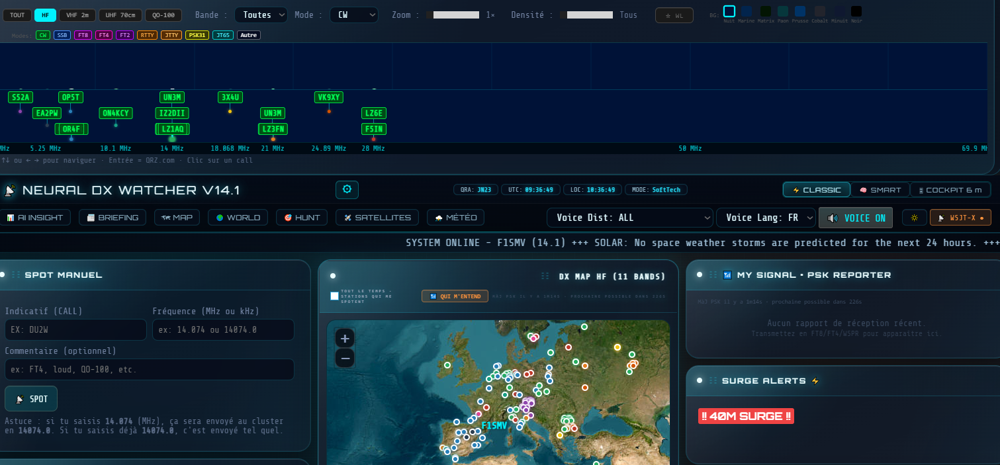

# 🛰️ Neural DX Watcher 14.1

> Real-time DX monitoring platform for amateur radio — F1SMV / JN23
> Raspberry Pi 4 · Flask · SQLite · Leaflet.js · WSJT-X · Adaptive AI Insight Engine

---

## 📸 Preview



---

## Table of contents

- [Overview](#-overview)
- [Technical stack](#-technical-stack)
- [Version history](#-version-history)
  - [v14.1 — Alpha-5 and daily TLE update](#v141--alpha-5-and-daily-tle-update-current)
  - [v14.0 — Nightly memory, measured Auto-Test, automatic startup](#v140--nightly-memory-measured-auto-test-automatic-startup)
  - [v13.5 — Satellite synchronisation and TLE control](#v135--satellite-synchronisation-and-tle-control)
  - [v13.4 — Amateur radio satellite panel and RSGB feed](#v134--amateur-radio-satellite-panel-and-rsgb-feed)
  - [v13.3 — Readable satellites, educational AI Insight](#v133--readable-satellites-educational-ai-insight)
  - [v13.2 — Experimental AI Insight panels](#v132--experimental-ai-insight-panels)
  - [v13.1 — Consolidation & release preparation](#v131--consolidation--release-preparation)
  - [v13.0 — Adaptive Insight Engine](#v130--adaptive-insight-engine)
  - [v12.7 — Fixes & Polish](#v127--fixes--polish)
  - [v12.6 — VOACAP HF Propagation](#v126--voacap-hf-propagation)
  - [v12.5 — AI Insight Engine (origin)](#v125--ai-insight-engine-origin)
  - [v12.2 — MSK144 & Satellites](#v122--msk144--satellites)
  - [v12.1 — Beacons & Lightning](#v121--beacons--lightning)
  - [v11.x — Data & Infrastructure](#v11x--data--infrastructure)
  - [v9.5 — Foundations & Roadmap](#v95--foundations--roadmap)
- [AI Insight page — detailed architecture](#-ai-insight-page--detailed-architecture)
- [Deployment](#-deployment)
- [Available APIs](#-available-apis)

---

## 🎯 Overview

Neural DX Watcher is a personal web application for DX monitoring by amateur radio operators. It aggregates in real time the DX telnet cluster spots, WSJT-X decodes received over local UDP, solar propagation data (SFI/K/A), space weather, VHF/UHF beacons, SGP4 satellite tracking and weather/lightning correlations.

Since v12.5, the application includes an **adaptive artificial intelligence engine** that predicts propagation openings, measures its errors, and optimises itself every night — an experimental ambition for a solo project on a Pi.

---

## 🔧 Technical stack

| Component | Technology |
|-----------|------------|
| Backend | Python / Flask (local virtual environment observed: Python 3.13) |
| Database | SQLite (`analytics.sqlite`, `predictor.sqlite`) |
| Frontend | Leaflet.js, SortableJS, Space Grotesk / IBM Plex Mono |
| Solar data | NOAA SWPC (SFI, K, A) |
| HF propagation | VOACAP (integrated in v12.6) |
| Weather/Tropo | Open-Meteo (850 hPa, humidity, CAPE) |
| Lightning | Blitzortung MQTT (3×3 grid around the QTH) |
| Received signals | PSK Reporter MQTT + HTTP fallback |
| WSPR | wspr.live |
| Satellites | Space-Track daily OMM (TLE, primary since v14.1), AMSAT and CelesTrak (fallbacks), SatNOGS (frequencies), SGP4 |
| DX cluster | Telnet (dxfun.com:8000, dxc.k0xm.net:7300, dxc.nc7j.com:7373) |
| WSJT-X | Local UDP port 2237 (real-time decodes) |
| VHF beacons | dl0tud.tu-dresden.de (IARU R1 CSV, monthly auto-update) |

---

## 📜 Version history

---

### v14.1 — Alpha-5 and daily TLE update ← CURRENT

**Period:** November 2026  
**Status:** to be validated on Raspberry Pi after deployment.

#### Changes from v14.0

**Satellites — NORAD numbers above 99999**

- **Alpha-5 notation:** the TLE parser now accepts the NORAD Alpha-5 notation (one letter + four digits, without I or O). For example `A1101` stands for 101101, UNNE-1B (HADES-E2). The AMSAT text format did not contain these numbers.
- **Daily update from Space-Track:** `deploy/omm_spacetrack.sh` downloads every night the orbital elements (OMM JSON) of the active satellites listed in `data/satellites_config.json` into `data/omm_local.json`. The script is scheduled by cron at 04:30. See `deploy/README-omm-spacetrack.md`.
- **Local source first:** `data/omm_local.json` is read first when loading TLEs, before the fallback sources (AMSAT, CelesTrak).
- **Credentials kept out of the repository:** `~/.config/neural-dx/spacetrack.env`, permissions `600`, never versioned.
- **Synchronisation:** `tools/sync_satellites.py` uses `data/omm_local.json` as an additional TLE source. An unreachable source no longer stops the synchronisation.

**Diagnostics**

- TLE download failures are logged at `WARNING` level (instead of `DEBUG`), with the error type. A silent failure can no longer go unnoticed.

**Startup**

- `start.sh`: the dependency check is fixed (explicit import of `importlib.util`). Without this fix, the test failed and dependencies were reinstalled at every launch.
- `start.sh` refuses a manual launch if the `neural-dx-watcher.service` systemd service is already running.

#### Checks after deployment

- `./start.sh`: the log shows `TLE locale data/omm_local.json: N satellites`, then `N/N satellites d'intérêt trouvés`.
- `~/Neural-DX-Watcher/deploy/omm_spacetrack.sh` prints `Space-Track OK: N objets`.
- `tail -5 ~/Neural-DX-Watcher/omm_spacetrack.log` shows a `Space-Track OK` line dated from the night.
- `python3 tools/sync_satellites.py` prints the report; add `--write` only after reviewing it (`.bak` backup is created).
- `python3 -m unittest test_tle_omm test_sync_satellites -v`: all tests pass.

#### Known limitations

- Adding a satellite is done by editing `data/satellites_config.json`: the page does not support it yet. The Space-Track download only covers the satellites in that file.
- CelesTrak remains unreachable from the Pi: it is only a fallback.
- The daily update must be installed on each machine (credentials and cron, see the dedicated README).
- `tools/sync_satellites.py` only modifies the registry with `--write`. Check that the application reads `data/ham_satellites.json`.

#### Modified files

`webapp.py` (Alpha-5 parser, WARNING logging, loading of `omm_local.json`); `tle_omm.py` and `test_tle_omm.py` (new); `deploy/omm_spacetrack.sh` and `deploy/README-omm-spacetrack.md` (new); `tools/sync_satellites.py`, `tools/README-sync-satellites.md` and `test_sync_satellites.py`; `start.sh`, `version.json`, `README.md`.

---

### v14.0 — Nightly memory, measured Auto-Test, automatic startup

- **Memory:** the backtester aggregates spots in SQLite instead of loading them into Python. On the Pi, the nightly growth of the web app (+17 MB per cycle) disappears: measured from 15 to 17 November, a difference under 2 MB.
- **Auto-Test:** the probability is the measured rate of listening days when the band was heard at this UTC hour (30 days, 7 days minimum). The fixed table is only a fallback, shown on screen as uncalibrated.
- **Services:** `deploy/install_services.sh` installs the application's systemd service and the weekly satellite synchronisation (Sunday 05:30).
- **Diagnostics:** `tools/diag_memory.py` gives the memory growth verdict from the nightly RSS log.
- **HF forecast:** the home page and the insight read the same internal model (`voacap_model.py`): solar time at the midpoint, continuous LUF in distance, labels "internal estimate" and "model score". Verified: 192 comparisons, no difference.

---

### v13.5 — Satellite synchronisation and TLE control

**Period:** November 2026  
**Status:** to be validated on Raspberry Pi after deployment.

#### Changes from v13.4

**Satellites — automatic NORAD and TLE**

- **Automatic NORAD:** `tools/sync_satellites.py` finds the NORAD number of each satellite in the registry in SatNOGS, including through the alias in parentheses (e.g. "AO-129 (ERMINAZ-2U)"). 26 numbers were found automatically on the first run.
- **TLE check:** orbital elements are read from AMSAT (`nasa.all`), since CelesTrak is unreachable from the Pi. A satellite gets `tle_disponible: true` if its NORAD appears in these elements.
- **Status rules:** an "upcoming" satellite without a NORAD moves to "unconfirmed status", since an announced launch must be documented. A missing TLE does not change the operational status: an active satellite without a TLE stays active, but cannot be tracked.
- **Discovery as report only:** new SatNOGS satellites (upcoming or launched less than 180 days ago) are listed in the report. They enter the registry only with `--discover`, so the page is not overloaded.
- **Server-side guard:** `POST /api/satellites/config` refuses to activate a satellite missing from the TLE cache (HTTP 409, "TLE indisponible", with the names). The refusal does not depend on the interface.

**Data corrections**

- **LilacSat-2:** NORAD 40908 (not 39444, which is FUNcube-1 / AO-73) in `SATELLITES_DEFAULT`.
- **QO-100 (Es'hail-2 / P4A):** active status, confirmed by operations.
- **AO-129 and AO-130 (ERMINAZ-2U/2V):** active status (in service according to AMSAT-DL); no TLE yet, so they cannot be tracked.

#### New APIs (v13.5)

| Endpoint | Description |
|----------|-------------|
| `POST /api/satellites/config` | Activation of tracked satellites; refuses (HTTP 409) any satellite missing from the TLE cache |

#### Checks after deployment

- `python3 -m unittest test_sync_satellites test_enrich_satellites` shows 32 tests OK.
- `python3 tools/sync_satellites.py` prints the report; add `--write` only after review (`.bak` backup).
- Try activating AO-129 from the selector: the "TLE indisponible" refusal must appear as long as no TLE is published.

#### Known limitations

- Nine satellites still need a manually entered NORAD: CAS-7A, CAS-7C, CAS-8A/8B/8C/8D (group), BY70-8, CRAC-01, REALOP, AMSAT CubeSat on Artemis, CSSARC, SIDLOC PQ-03 to 06 and NIS-PQ (group). Group entries must first be split into individual satellites.
- Synchronisation is not scheduled: it runs on demand.
- CelesTrak is unreachable from the Pi (timeout): only the AMSAT source is used for TLEs.
- `tle_disponible` in the registry is indicative; the server guard relies on the actual TLE cache.
- v13.4 limitations unchanged: manually updated registry, nightly memory growth.

#### Modified files

`tools/sync_satellites.py` and `test_sync_satellites.py` (new); `tools/enrich_satellites.py` and `test_enrich_satellites.py`; `data/ham_satellites.json`; `webapp.py` (LilacSat-2 NORAD, activation guard, `APP_VERSION`); `start.sh`, `version.json`, `README.md`, `README_EN.md`.

---

### v13.4 — Amateur radio satellite panel and RSGB feed

**Period:** November 2026  
**Status:** to be validated on Raspberry Pi after deployment.

#### Changes from v13.3

**DX news**

- **RSGB feed:** DX-World returns HTTP 403 from the Pi. Replaced by the RSGB GB2RS DX News feed. Briefing sources: ARRL, NG3K, RSGB.

**Satellites — "Amateur radio" panel**

- **Curated registry:** `data/ham_satellites.json` lists 39 satellites from 7 sources, with status (upcoming, being deployed, active, unconfirmed status, out of service), published launch date, frequencies and a "recently active" indicator.
- **Cross-confirmation:** a satellite is only confirmed with at least 2 distinct sources. A source cited twice counts once.
- **Statistics:** total, number of confirmed satellites and number of recently active ones.
- **Offline:** the panel reads from the local registry; the page depends on no external source.

#### New APIs (v13.4)

| Endpoint | Description |
|----------|-------------|
| `GET /api/satellites/ham_radar` | Amateur radio panel: satellites grouped by status, with sources and confirmation |

#### Checks after deployment

- `python3 -m unittest test_ham_radar` shows 17 tests OK.
- `curl -s http://localhost:8000/api/satellites/ham_radar` returns JSON with the groups `a_venir`, `en_deploiement`, `actif`, `statut_inconnu` and `hors_service`.

#### Known limitations

- The registry is updated manually; its `updated` field shows its date.
- The page refreshes every 30 minutes.
- Nightly memory growth of the web app (≈ +17 MB per night): to be addressed before v14 (see the Phase 0 closure).
- DX-World remains blocked (403): no workaround is planned.

#### Modified files

`ham_radar.py` and `test_ham_radar.py` (new), `data/ham_satellites.json` (new, versioned thanks to an exception in `.gitignore`), `webapp.py`, `templates/satellites.html`, `.gitignore`, `start.sh`, `version.json`, `README.md`, `README_EN.md`.

---

### v13.3 — Readable satellites, educational AI Insight

**Period:** October 2026  
**Status:** version being validated on Raspberry Pi. The checks in the dedicated section are still to be done after deployment.

#### Changes from v13.2

**Satellites**

- **Co-visibility restored:** the route `GET /api/satellites/covisibility/<norad>` was missing, hence the "Network error while computing" message. It now computes, over 48 h at a one-minute step, the windows when the satellite is above the horizon both from the QTH and from the correspondent's locator (Maidenhead format checked).
- **Changed satellites banner:** every addition or removal from the active list is logged (`data/satellites_changes.json`) and shown with its name and NORAD until acknowledged ("OK, compris"). The first launch creates the reference snapshot without showing a banner.
- **Direct removal:** the "TLE indisponible" banner offers a **✕ Retirer** button per satellite. The ⚙ "Gérer" button is highlighted and its label corrected.

**AI Insight**

- **Readable HF trend:** explicit headers (Recent activity, Usual activity, Variation, Reliability z), tooltips, and a 14 px orange reading guide.
- **Mobile:** on phones, the table becomes one card per band, with no horizontal scrolling.
- **Icon:** brand icon at the top of the page and as the browser tab icon.

**Version:** `APP_VERSION = '13.3'`. Trend error messages refer to webapp.py v13.3.

#### New APIs (v13.3)

| Endpoint | Description |
|----------|-------------|
| `GET /api/satellites/covisibility/<norad>?locator=IO91` | 48 h co-visibility windows between the QTH and the correspondent's locator |
| `GET /api/satellites/changes` | Unacknowledged satellite additions and removals |
| `POST /api/satellites/changes/ack` | Acknowledges all displayed changes |

#### Checks after deployment

- `curl -s "http://localhost:8000/api/satellites/covisibility/25544?locator=JN23"` returns JSON (code 200), with `windows` or an explicit `error`.
- Removing AO-92 and AO-109 with "✕ Retirer": the changes banner appears with the names, then disappears after "OK, compris".

#### Known limitations

- **HF model per pair** (`predictor.py`): deployed on the Pi. Average HF probability of about 0.35 over the last hour (13 predictions); the sample remains small. Ranking power varies by period.
- **Auto-Test:** probabilities come from a fixed activity table (× 1.1 for FT8), uncalibrated. They do not reflect the HF model and will be replaced by measured rates.
- `start.sh` and `version.json` must be set to 13.3 at deployment.
- Co-visibility relies on cached TLEs and a one-minute resolution.

#### Modified files

- `webapp.py`: `APP_VERSION`, co-visibility route, change log (`_sync_sat_changes`), `changes` and `changes/ack` routes.
- `predictor.py`: HF model per band × prefix pair (30 days, smoothed toward the global rate).
- `templates/satellites.html`: changes banner, ✕ Retirer button, ⚙ Gérer button.
- `templates/ai_insight.html`: HF trend columns and legend, mobile cards, icon.

---

### v13.2 — Experimental AI Insight panels

**Period:** October 2026  
**Status:** version being validated on Raspberry Pi. Panels marked **[EXPERIMENTAL]** are measurements under validation: they are not a validated forecast and must not guide an operating decision.

#### Changes from v13.1

- **Honest HF map:** for HF bands, the displayed probability is now the **realised base rate** (share of 3-hour windows in which at least one spot was received), with the note "HF model not demonstrated". The previous HF score had no out-of-sample discriminating power (AUC ≈ 0.51, negative Brier gain); it is no longer displayed.
- **HF trend model (backend):** HF forecasts rely on a prefix × band × UTC time-slot model (3-hour windows), computed over 120 days of history, with a prior weighted toward the base rate. Out-of-sample validation over 4 time blocks: AUC from 0.73 to 0.78. The Brier gain over the base rate is not constant from one split to another, so the map shows the base rate, not the score.
- **Drift detection:** for each HF band, comparison of the share of prefixes heard per 3-hour window over the last 14 days and over the 60 preceding days (Welch test, z statistic). A **rising** or **falling** state is only flagged if |z| ≥ 3 and the gap is at least 2 points.
- **"Unknown" band** excluded from trend calculations.

#### Experimental panels

| Panel | Status | What it shows | Current limitation |
|-------|--------|---------------|--------------------|
| HF map (probability box) | [EXPERIMENTAL] | Realised base rate per band, without score | "HF model not demonstrated" note |
| HF trend per band | [EXPERIMENTAL] | Rising / falling / stable / insufficient, with recent and reference values, gap and z | "Insufficient" until the threshold of 20 windows per period is reached |
| Precision & calibration | [EXPERIMENTAL] | Brier, ECE, gain and score-to-outcome curve for ES, tropo and HF | HF: only counts forecasts after the `HF_V2_SINCE_TS` switch; sample still small |
| Auto-Test | [EXPERIMENTAL] | Predictions issued, confirmed, freshness score | Score scale to be confirmed |
| Module status | Usable | Status of each module, probable cause and fix | — |

Panels can be moved (drag and drop); the order is stored in the browser.

#### Conditions for meaningful figures

- **HF trend:** at least **20 three-hour listening windows** (≈ 60 h) in the recent period (14 days) **and** in the reference period (60 days). With a Raspberry Pi listening continuously, the minimum is reached after **about 2.5 weeks** of operation; the full 60-day reference takes **about 10 weeks**. A Pi outage extends this delay accordingly.
- **Status at drafting (17/10/2026):** 56 windows over 120 days of history, i.e. about 168 h of recorded listening. All bands remain "insufficient". This status must be rechecked against the deployed version.

#### Known limitations

- **HF calibration:** only HF forecasts issued after the `HF_V2_SINCE_TS` switch (calibration.py) are counted; earlier ones are excluded. The sample is small at first.
- **Solar elevation at the midpoint:** tested out of sample (gain of 0.01 to 0.02 AUC beyond the band × prefix rate and the hour). Not integrated into scoring: status NOT VALIDATED.
- **Historical SFI and Kp:** not recorded (`solar_log` empty). The HF model does not use the ionisation index.
- **Generalisation:** the v13.2 measurements rely on a single station and 120 days of history. They cannot be generalised to other QTHs without new validation.

#### Modified files

- `webapp.py`: new route `GET /api/insight/trend.json`, inserted before the diagnostic route.
- `predictor.py`: HF trend model, drift detection, per-period window counters, exclusion of "Unknown".
- `templates/ai_insight.html`: "HF trend per band" panel, drift badges on HF rows, explanation of conditions.
- `calibration.py`: HF switch (`HF_V2_SINCE_TS`); HF calibration ignores earlier forecasts.

---

### v13.1 — Consolidation & release preparation

**Period:** October 2026  
**Status:** working version observed locally; publication and functional validation to be confirmed.

This step continues the adaptive engine work introduced in v13.0. The local files examined show work on the **AI Insight** page, calibration, notifications and interface components. The points below describe the **observed scope of work**, not a list of features all verified in production.

#### Observed changes and files

- **AI Insight:** changes in progress in `templates/ai_insight.html`; a variant `templates/ai_insightv13.1.html` is present and should be compared before publication.
- **Calibration and prediction:** `calibration.py` present and local changes in `analytics.py`; check the integration and calibration results on real predictions.
- **Adaptive Insight Engine:** `adaptive/` directory present with FSM, backtesting, optimisation, model registry, QualityGate, DriftMonitor, NightlyCycle and associated tests; operational status to be confirmed by the tests of the published version.
- **Auto-Test interface:** CSS/JavaScript components present both under `static/` and `static/widgets/`. The files are not identical; check their references and keep only the versions actually used.
- **Alerts:** local changes in `ntfy_alerts.py` and presence of `static/storm-alert.js`; check the notification scenarios before declaring these features delivered.
- **Maintenance:** changes in `start.sh`, `webapp.py` and `templates/index.html`; cleanup of old fix scripts and of `webapp.py` backup copies in the Git working tree.
- **Documentation:** French and English READMEs harmonised, with history presented from the most recent version to the oldest.

#### Validation before publication

- Run the tests applicable to the adaptive engine and check the start-up via `./start.sh`.
- Check the routes/APIs actually exposed, in particular the availability of the VOACAP calculation and the calibration indicators.
- Confirm references to static files and templates before removing apparent duplicates.
- Do not publish SQLite databases, logs, private configuration files or API tokens; check `git status` and `git diff --cached` before the push.
- **Local infrastructure:** EXT4 errors were detected on the SD card during the October 2026 backups. Repair the file system offline and validate a restore before considering the system image a reliable backup.

---

### v13.0 — Adaptive Insight Engine

**Date:** 26 September – 1 October 2026

The most ambitious version. The AI Insight Engine becomes **adaptive**: it predicts, measures its errors, optimises itself automatically every night, and loops back on itself. Developed against a 31-section specification — 9 sections delivered, 69/69 unit tests.

#### v13.0 deliveries

| Section | Module | Lines | Tests | Status |
|---------|--------|-------|-------|--------|
| §8 | PropagationFSM (7 states × 5 bands) | 460 | 10/10 | ✅ |
| §12 | Backtester (ECE / Brier / F1) | 200 | 8/8 | ✅ |
| §13 | Optimizer (grid search) | 210 | 8/8 | ✅ |
| §14 | Models (versioning, lifecycle) | 280 | 14/14 | ✅ |
| §14b | Live scoring from `active_model.config` | — | — | ✅ |
| §15 | QualityGate (4 checks) | 165 | 14/14 | ✅ |
| §24 | Auto-Test (live feedback loop) | 270 | 5/5 | ✅ |
| §25 | DriftMonitor | 180 | 4/4 | ✅ |
| §32 | NightlyCycle (3h UTC, 7d/14d/30d) | 280 | 6/6 | ✅ |

#### New radio mode: JTTY

**JTTY** (WSJT-X 3.2.0-rc1) integrated into scoring, filters and UI badges. Non-synchronised digital mode proposed by K1JT, close to RTTY. Preliminary band plan: 11 meeting frequencies (1.838–144.160 MHz). UI colour: orange `#ff9e2c`.

#### Auto-Test widget

New panel on the AI Insight page: **🔄 Auto-Test (Feedback Loop)**. Shows in real time the predictions issued, the validations received and the freshness score. Bilingual FR/EN legend (14 px, orange) to guide the reading of the metrics.

---

### v12.7 — Fixes & Polish

**Date:** September 2026

- WSPR callsign fixes (formats `/P`, `/MM`, etc.)
- DX geolocation correction for some DXCC entities after the cty.dat v11 fix
- Extension of the VOACAP bands covered by the propagation calculation
- Stabilised panel drag & drop (SortableJS)
- Expedition badge: visual indicator for active rare prefixes

---

### v12.6 — VOACAP HF Propagation

**Date:** September 2026

Integration of **VOACAP** (Voice of America Coverage Analysis Program), the reference standard for point-to-point HF propagation prediction:

- Python backend calculation of circuit probabilities per band (80 m → 10 m) for a path from the QTH to a target area
- Visual panel in AI Insight with probabilities per band and UTC hour
- Explanatory note: the calculation covers **one specific path**, not the overall activity of the band

---

### v12.5 — AI Insight Engine (origin)

**Date:** September 2026 — *Turning point*

This is where Neural DX Watcher changes nature. Until v12.2, the application was a real-time aggregator. In v12.5, it acquires an **autonomous brain**.

#### analytics.py module

Fully autonomous module with its own SQLite database `data/analytics.sqlite`. Never coupled to `predictor.py`. Cascading sources:
1. `predictor.sqlite` (if available and intact)
2. `analytics.sqlite` (primary source)
3. In-memory buffer (last-resort fallback)

#### AI Insight page — initial version

Complete redesign with UTC timestamps on each block. Panels: propagation per band, active DXCC (2 h), SPD calibration, Solar/Geomag, narrative DX Briefing FR/EN.

#### Critical bug found in production

`history_maintenance_worker` wrapped `verify_predictions()` in `except: logger.debug(...)` — SQLite corruption (SD card power loss) failed silently for weeks and froze the "measured reliability" panel. Fix: all background worker errors logged at `WARNING` level at minimum.

---

### v12.2 — MSK144 & Satellites

**Date:** September 2026

- **MSK144:** detection range corrected (144 350–144 370 kHz)
- **PSK Reporter:** real-time "MY SIGNAL" MQTT feed (who hears you, without HTTP polling)
- **Satellites:** 100% local co-visibility panel via sgp4 — two satellites simultaneously visible from the QTH. No external dependency, unlike HamClock (hams.at)
- AO-92 / AO-109: deorbited in 2024, absent TLEs = correct behaviour (not a bug)

---

### v12.1 — Beacons & Lightning

**Date:** September 2026

- **Beacons page** (`weather.html`): IARU R1 beacon reception panel, monthly auto-update worker from dl0tud.tu-dresden.de
- **Basemap:** migration from CARTO to Esri Dark Gray Canvas (CARTO now requires API keys). Tile order `{z}/{y}/{x}`
- **Critical bug restored:** `get_weather_alerts()` accidentally removed by a badly calibrated `str_replace`

---

### v11.x — Data & Infrastructure

**Date:** August 2026

- **NOAA Kp:** parser fix — the endpoint returns `[{"time_tag":..., "Kp":...}]` (JSON-of-objects). It had silently returned `None` for weeks
- **Blitzortung MQTT:** topic format fix (`blitzortung/1.1/s/p/e/#`, slash-separated) — CONNACK=0 but no data
- **cty.dat longitude:** systematic conversion `lon = -raw_lon` (West-positive → East standard). A conditional left Asian entities mirrored in the Atlantic
- **Distances:** filtering of impossible distances (FT8 capped at ~1,000 km, half circumference = 20,037 km)
- **PSK Reporter MQTT:** topic `pskr/filter/v2/+/+/{MY_CALL}/+/#`, MQTT priority with transparent HTTP fallback

---

### v9.5 — Foundations & Roadmap

**Date:** Summer 2026

First published version with a working cockpit: real-time Leaflet 6 m map, DX feed, HF/VHF band panels, basic satellite tracking. The v9.5 roadmap set out the major ambitions that shaped all later versions:

1. **Predictive engine** — probabilistic scoring per band/hour/season → *delivered in v13.0*
2. **ntfy.sh push alerts** — mobile notification for rare spot / 6 m opening → *in progress*
3. **DXCC hunting mode** — real-time LoTW cross-matching → *in progress*
4. **24 h timeline replay** — sporadic-E scrubber hour by hour → *planned*
5. **WSJT-X stats** — maximum decoded distance per band/hour → *planned*

---

## 🧠 AI Insight page — detailed architecture

The `/ai-insight` page is the experimental core of Neural DX Watcher v13.0.

### Complete closed loop

```
Real-time spots (DX cluster telnet + WSJT-X UDP)
              │
              ▼
┌─────────────────────────────────────────────────────┐
│  §8 — PropagationFSM                                │
│  7 states × 5 bands                                 │
│  IDLE→RISING→OPENING→STRONG→PEAK→DECLINING→CLOSED   │
│  Timestamps for start / peak / end of each opening  │
└──────────────────────────┬──────────────────────────┘
                           │ events
                           ▼
┌─────────────────────────────────────────────────────┐
│  §12 — Backtester                                   │
│  Replays the SQLite history                         │
│  Computes ECE / Brier / F1                          │
└──────────────────────────┬──────────────────────────┘
                           │ metrics
                           ▼
┌─────────────────────────────────────────────────────┐
│  §13 — Optimizer                                    │
│  Grid search: distance_bonus, FT8 weight, SPD cap   │
│  Selects the config with the best ECE               │
└──────────────────────────┬──────────────────────────┘
                           │ best candidate
                           ▼
┌─────────────────────────────────────────────────────┐
│  §14 + §15 — Models + QualityGate                   │
│  CANDIDATE → VALIDATED → ACTIVE → DEPRECATED        │
│  4 checks before promotion:                         │
│    ✓ ECE < 0.20      ✓ F1 > 0.60                   │
│    ✓ N_preds > 10k   ✓ Drift < 5% vs active model  │
│  Failure → candidate rejected, previous model kept  │
└──────────────────────────┬──────────────────────────┘
                           │ promoted config
                           ▼
┌─────────────────────────────────────────────────────┐
│  §14b — calculate_spd_score() — Live scoring        │
│  Reads active_model.config dynamically on each      │
│  call — the config from tonight runs from 03:01     │
└──────────────────────────┬──────────────────────────┘
                           │
              ┌────────────┤
              ▼            ▼
┌──────────────────┐  ┌────────────────────────────────┐
│ §32 NightlyCycle │  │  §25 — DriftMonitor            │
│ Every night      │  │  Monitors ECE drift            │
│ 03:00 UTC        │  │  Alerts on degradation         │
│ Tests 7d/14d/30d │  └──────────────┬─────────────────┘
│ → promotes best  │                 │ signals
└──────────────────┘                 ▼
                     ┌────────────────────────────────┐
                     │  §24 — Auto-Test               │
                     │  10 predictions/hour           │
                     │  Validated against real spots  │
                     │  score = 1 − age_min/60        │
                     │  Feeds DriftMonitor            │
                     │  continuously                  │
                     └────────────────────────────────┘
```

### What is novel

**1. Nightly self-calibration (NightlyCycle)**

The SPD scoring parameters are no longer hard-coded constants. Every night at 3 h UTC, the system replays 7, 14 and 30 days of history, objectively measures which window best predicts the next day's propagation, then automatically promotes the best model if the 4 checks pass.

**2. Immutable versioning with rollback**

Every tested configuration is permanently versioned in SQLite (`model_versions`). If a bad promotion is detected, rollback is possible. Cycle `CANDIDATE → VALIDATED → ACTIVE → DEPRECATED`.

**3. 7-state × 5-band propagation FSM**

`PropagationFSM` tracks 5 bands independently through 7 states, timestamping each opening precisely from start to peak to end. Usable data for training subsequent predictions.

**4. Auto-Test: live feedback in real time**

`adaptive/auto_test.py` issues 10 probabilistic predictions per hour (1 FT8 per band) and checks them against real spots as soon as they arrive (±1 h window). The match_score measures freshness: spot at 2 min → score 0.97, spot at 55 min → score 0.08. Automatic purge of unvalidated predictions older than 24 h.

**5. Dynamic SPD scoring (§14 integration)**

`calculate_spd_score()` reads the active model's config via `ModelRegistry.get_active_model()` on each call. Fully closed loop: data → learning → scoring → data.

### Experimental panels (v13.2)

See the v13.2 section for conditions and limitations. Summary:

- **[EXPERIMENTAL]** HF map (base rate, "HF model not demonstrated"), HF trend per band, Precision & calibration, Auto-Test.
- **Usable:** Module status.

### AI Insight page panels

| Panel | Data | Refresh |
|-------|------|---------|
| Propagation per band | 30 min spots, FSM states | 30 s |
| Solar + Geomag | NOAA SFI/K/A | 5 min |
| DX Briefing (FR/EN) | Automatic narrative summary | 2 min |
| VOACAP HF | Circuit probabilities per band/hour | Manual |
| SPD calibration | ECE/F1 of the active model | 5 min |
| FSM states | Real-time state per band | 30 s |
| Optimizer history | Runs, ECE, promotions | 1 min |
| Model versions | ACTIVE / CANDIDATE / DEPRECATED | 1 min |
| DriftMonitor | Rolling ECE, drift alerts | 1 min |
| 🔄 Auto-Test | Live predictions + validations | 10 s |

### Reading the Auto-Test widget

```
Predictions: 11
  → 1 bet issued per band at each UTC hour (10 bands = 10 bets)
  → Purged after 24 h if no spot validates them

Validated: 5 (45%)
  → 5 predicted bands received a real spot within the hour
  → The other 6: bands closed (normal for the current propagation)

Score: 0.98
  → Average freshness of the confirmations
  → 0.98 = spots arrived almost immediately after the prediction
  → Low score = band opened late in the hour (≈60 min)

Each validation feeds the DriftMonitor → NightlyCycle at 3 h UTC.
```

### Supported radio modes

| Mode | Key frequencies | UI colour |
|------|-----------------|-----------|
| FT8 | 14.074, 7.074, 50.313 MHz… | Violet `#a78bfa` |
| FT4 | 14.080, 7.047 MHz… | Pink `#ff00cc` |
| CW | CW segments per band | Yellow `#fbbf24` |
| SSB | SSB segments per band | Cyan `#22d3ee` |
| MSK144 | 144.360 MHz ±10 kHz | Dark cyan |
| PSK31 | 14.070–14.071 MHz | Yellow-green |
| RTTY | RTTY segments per band | Orange `#ff8800` |
| **JTTY** | **11 frequencies: 1.838–144.160 MHz** | **Orange `#ff9e2c`** |
| JT65 | JT65 segments | Cyan |
| AM / FM | AM/FM segments | Green |

---

## 🚀 Deployment

```bash
git clone https://github.com/F1SMV/Neural-DX-Watcher.git
cd Neural-DX-Watcher
./start.sh
```

> ⚠️ **Always use `./start.sh`**, never `python3 webapp.py` directly.
> The script activates the virtual environment (`venv/bin/python3`), checks dependencies and manages application start-up. Check its exact behaviour before deployment.

Daily TLE update (v14.1): see `deploy/README-omm-spacetrack.md` for the Space-Track credentials and the cron scheduling.

| URL | Page |
|-----|------|
| `http://<RASPBERRY_IP>:8000` | Home + 6 m cockpit |
| `http://<RASPBERRY_IP>:8000/ai-insight` | AI Insight Engine |
| `http://<RASPBERRY_IP>:8000/satellites` | Satellite tracking |
| `http://<RASPBERRY_IP>:8000/hunt` | DXCC hunting |
| `http://<RASPBERRY_IP>:8000/weather` | Weather + Beacons + Lightning |

---

## 📡 Available APIs

### Spots & DX

| Endpoint | Description |
|----------|-------------|
| `GET /spots.json?band=6m&mode=FT8` | Spots filtered by band/mode |
| `GET /api/map/spots.json` | Geolocated spots for the map |
| `GET /api/wsjtx/spots.json` | Real-time WSJT-X decodes |
| `GET /api/weather/wspr.json` | WSPR 2 m confirmation |
| `GET /api/psk_reporter.json` | PSK Reporter receptions |

### Propagation & Solar

| Endpoint | Description |
|----------|-------------|
| `GET /api/solar.json` | SFI/K/A + propagation status |
| `GET /api/voacap.json` | VOACAP predictions per band/zone |
| `GET /api/briefing.json?lang=fr` | Narrative DX Briefing |

### Diagnostics and trend (v13.2)

| Endpoint | Description |
|----------|-------------|
| `GET /api/insight/trend.json` | **[EXPERIMENTAL]** HF trend per band: state, recent and reference values, gap, z, window count per period |
| `GET /api/insight/diagnostic.json` | Status of each AI Insight page module, with probable cause and fix |

### Satellites (v13.3)

| Endpoint | Description |
|----------|-------------|
| `GET /api/satellites/covisibility/<norad>?locator=IO91` | 48 h co-visibility windows QTH ↔ locator |
| `GET /api/satellites/changes` | Unacknowledged satellite additions / removals |
| `POST /api/satellites/changes/ack` | Acknowledges displayed changes |
| `GET /api/satellites/ham_radar` | Amateur radio panel (v13.4): satellites grouped by status, sources and confirmation |
| `POST /api/satellites/config` | Activation of tracked satellites; refuses (HTTP 409) any satellite missing from the TLE cache (v13.5) |

### Adaptive Insight Engine (introduced in v13.0)

| Endpoint | Description |
|----------|-------------|
| `GET /api/adaptive/fsm.json` | Real-time FSM states per band |
| `GET /api/adaptive/events.json` | History of detected openings |
| `GET /api/adaptive/fsm_stats.json` | Global FSM statistics |
| `POST /api/adaptive/optimize.json` | Triggers the optimizer manually |
| `GET /api/adaptive/optimizer_runs.json` | Run history |
| `GET /api/adaptive/models/active.json` | Active model + current config |
| `GET /api/adaptive/models/candidates.json` | Candidates awaiting validation |
| `GET /api/adaptive/models/versions.json` | All versions |
| `GET /api/adaptive/qg/status.json` | QualityGate: thresholds + status |
| `POST /api/adaptive/qg/validate/<id>.json` | Manual validation of a candidate |
| `GET /api/adaptive/nightly/latest.json` | Latest NightlyCycle runs |
| `POST /api/adaptive/nightly/run.json` | Triggers NightlyCycle manually |
| `GET /api/adaptive/autotest/stats.json` | Global Auto-Test statistics |
| `GET /api/adaptive/autotest/latest.json` | Latest predictions + validations |
| `POST /api/adaptive/autotest/predict.json` | Creates a manual prediction |

---

## 📊 Specification status — v13.0 reference

**Documented reference for v13.0: 9 / 31 sections delivered · 69 / 69 tests.** These results do not constitute a new validation campaign for v13.1.

| Section | Feature | Status |
|---------|---------|--------|
| §8 | PropagationFSM | ✅ Live |
| §12 | Backtester | ✅ Live |
| §13 | Optimizer | ✅ Live |
| §14 | Models (versioning) | ✅ Live |
| §14b | Dynamic scoring | ✅ Live |
| §15 | QualityGate | ✅ Live |
| §24 | Auto-Test (feedback loop) | ✅ Live |
| §25 | DriftMonitor | ✅ Live |
| §32 | NightlyCycle | ✅ Live |
| §2 | Distribution (GitHub / Docker) | 🔜 |

---

## 🔭 Next steps

- **ntfy.sh alerts** — mobile notification for rare spot / 6 m opening
- **DXCC hunting mode** — real-time LoTW cross-matching, showing only what is missing
- **24 h timeline replay** — scrubber to review a sporadic-E opening hour by hour
- **Live JTTY** — active tracking once WSJT-X 3.2.0 is a stable release
- **§24b** — predictions based on SFI + UTC hour

---

*Neural DX Watcher v14.1 — F1SMV — JN23 — La Seyne-sur-Mer, France*
* you can contact me via X
* design by F1SMV, programmed with Claude AI
*Initial history written for earlier versions; documentation update: November 2026.*
